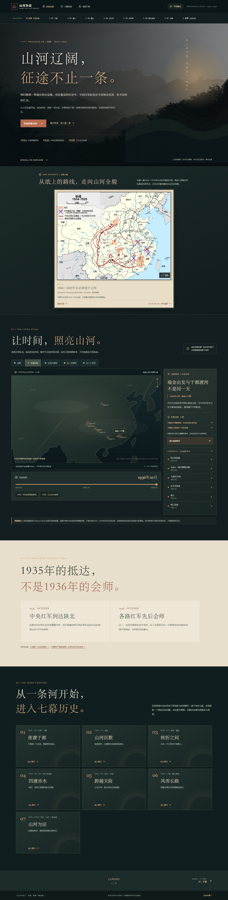

# 山河为证
### 一段长征，不止一条历史征途

**鼠哥（蒋松锡） · 沉浸式二维历史互动作品**

[**立即进入作品 · 在线体验 ↗**](https://ndshuge.github.io/shanhe-preview/) · [**七幕历史**](https://ndshuge.github.io/shanhe-preview/?scene=prologue%23chapter-directory) · [**美术图册**](https://ndshuge.github.io/shanhe-preview/?scene=artwork-library)

  

---

> **山河辽阔，征途不止一条。**  
> 跟随时间与事件，穿过1934—1936年的山河，在历史资料、二维画面与触摸互动之间，重新认识长征。

## 作品看点

| 内容 | 体验 |
| --- | --- |
| 动态历史总览 | 四路红军事件时间轴、地图与事件渐进展开 |
| 七幕历史叙事 | 于都、湘江、遵义、赤水、泸定、雪山草地、抵达与会师 |
| 各具特色的二维交互 | 河谷、档案、时间方向图、事件对比和分层环境 |
| 历史证据入口 | 关联公开史料、作者与艺术作品来源 |
| 全片配乐 | *Hymn To The Dawn*，由观众主动开启或关闭 |

## 如何观看

打开 **[https://ndshuge.github.io/shanhe-preview/](https://ndshuge.github.io/shanhe-preview/)**，从序章开始探索；支持手机及桌面浏览器，无需注册。音乐初始静音，点击页眉声音图标后开始播放。

## 历史与艺术声明

作品采用 Natural Earth 现代陆地轮廓和近似地理事件定位，地图动态连线用于表达**历史事件先后**，并非经过考证的长征军事行军路线。作品中后世历史主题绘画不等于现场照片；各章提供史料索引，摄影、绘画及地图的来源在结语列出。

## 作者与鸣谢

**作品作者：鼠哥（蒋松锡）**

配乐：**'Hymn To The Dawn' by Scott Buckley - released under CC-BY 4.0. www.scottbuckley.com.au**  
[音乐原始页面](https://www.scottbuckley.com.au/library/hymn-to-the-dawn/) · [CC BY 4.0](https://creativecommons.org/licenses/by/4.0/)

历史绘画、地图及当代风光摄影各归属原作者，逐项来源与许可情况见作品内致谢及本仓库 [LICENSE-NOTICES.md](./LICENSE-NOTICES.md)。

## 关于这个仓库

本仓库是**纯静态发布仓库**，用于展览和 GitHub Pages 托管；不包含开发工程源代码、内部研究文档或私人资料。请勿将仓库内第三方素材视为作者个人授权的可自由再分发资源。
